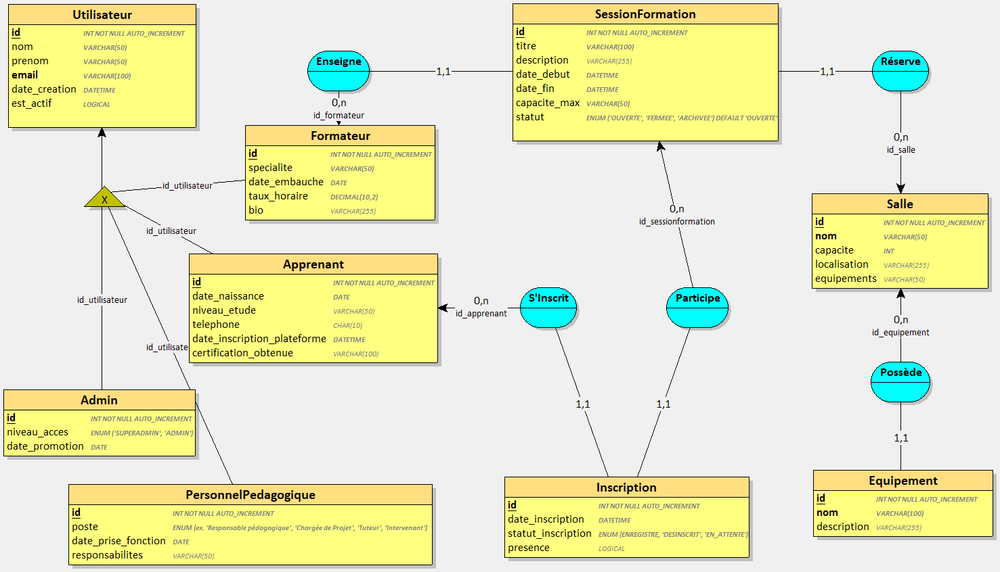
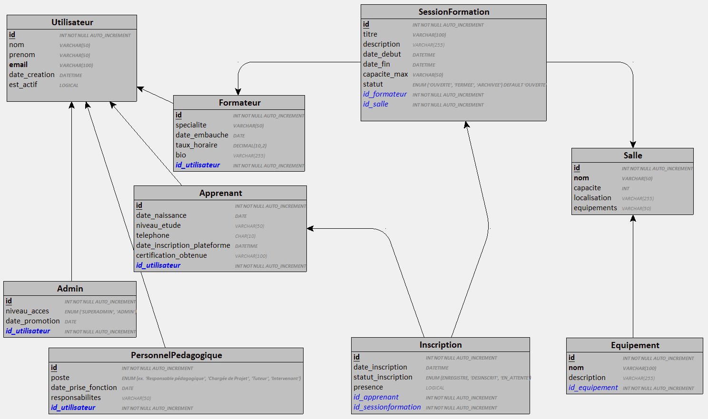

# CF-Tech : base de données pilotée par un ORM

Base de données relationnelle du centre de formation **CF-Tech**, conçue avec **SQLModel / SQLAlchemy**, validée avec **Pydantic** et destinée à évoluer avec **Alembic**.

## Sommaire

- [CF-Tech : base de données pilotée par un ORM](#cf-tech--base-de-données-pilotée-par-un-orm)
  - [Sommaire](#sommaire)
  - [1. Contexte et objectifs](#1-contexte-et-objectifs)
  - [2. Stack technique](#2-stack-technique)
  - [3. Installation](#3-installation)
  - [4. Structure du projet](#4-structure-du-projet)
  - [5. Modèle de données](#5-modèle-de-données)
    - [Choix d'architecture](#choix-darchitecture)
    - [Schémas](#schémas)
    - [Tables et énumérations](#tables-et-énumérations)
    - [Contraintes clés](#contraintes-clés)
  - [6. Validations métier](#6-validations-métier)
  - [7. Utilisation](#7-utilisation)
    - [Créer la base](#créer-la-base)
    - [Insérer et afficher des données](#insérer-et-afficher-des-données)
    - [Lancer le projet](#lancer-le-projet)
  - [8. Migrations Alembic](#8-migrations-alembic)
  - [9. Travail collaboratif](#9-travail-collaboratif)
  - [10. État d'avancement](#10-état-davancement)
  - [11. Auteurs](#11-auteurs)

---

## 1. Contexte et objectifs

**Contexte.** CF-Tech dispense des cours et des ateliers sur les technologies numériques. Les sessions, les salles, les formateurs et les apprenants étaient gérés à la main, avec des fichiers Excel et un ERP vieillissant. La direction souhaite un système centralisé, plus robuste, basé sur une base relationnelle pilotée par un ORM.

**Ce que le système doit permettre :**

- gérer l'ensemble des utilisateurs de la plateforme (apprenants, formateurs, staff pédagogique, administrateurs) ;
- suivre les sessions de formation (planning, salle, formateur, capacité) ;
- enregistrer les inscriptions des apprenants aux sessions et leur présence ;
- garantir la qualité des données à l'insertion (emails valides, dates cohérentes, âge minimal, unicité des comptes, etc.) ;
- faire évoluer le schéma (nouveaux rôles, nouveaux champs) sans interrompre l'exploitation, grâce aux migrations.

**Objectifs du projet :**

1. Concevoir le schéma relationnel en SQLModel / SQLAlchemy : utilisateurs, salles et équipements, sessions, inscriptions.
2. Valider les données à l'entrée avec Pydantic : format des emails, cohérence des dates (`date_debut < date_fin`), âge minimal de 16 ans, capacité des salles, non-chevauchement des sessions.
3. Mettre en place Alembic pour gérer les migrations successives du schéma.
4. *(Bonus)* Développer une interface graphique avec un tableau de bord de reporting.

## 2. Stack technique

| Domaine | Outil |
|---|---|
| Langage | Python 3.10 ou supérieur (syntaxe `X \| None`) |
| ORM | SQLModel / SQLAlchemy |
| Validation | Pydantic v2 (`EmailStr` via `email-validator`) |
| Affichage console | tabulate |
| Migrations | Alembic *(à mettre en place)* |
| Base de données | SQLite (`db/CFTeck.db`) |
| Interface (bonus) | à définir (Streamlit, Tkinter ou Flask) |

## 3. Installation

```bash
# 1. Cloner le dépôt
git clone <url-du-depot>
cd CF-Tech

# 2. (Recommandé) créer un environnement virtuel
python -m venv .venv
source .venv/bin/activate        # Windows : .venv\Scripts\activate

# 3. Installer les dépendances
pip install -r requirements.txt
```

Le dossier `db/` doit exister avant le premier lancement : SQLite crée le fichier `CFTeck.db`, pas le dossier.

## 4. Structure du projet

```text
CF-Tech/
├── main.py              # Point d'entrée du projet
├── classes/             # Modèles SQLModel : une classe = une table
│   ├── utilisateur.py   # Utilisateur (champs communs)
│   ├── apprenant.py     # Apprenant + enum NiveauEtude
│   ├── formateur.py     # Formateur
│   ├── personnel.py     # Personnel (staff pédagogique)
│   ├── admin.py         # Admin + enum AccesAdmin
│   ├── salle.py         # Salle
│   ├── equipement.py    # Equipement (rattaché à une salle)
│   ├── session.py       # SessionFormation + enum StatutSession
│   └── inscription.py   # Inscription + enum StatutInscription
├── db/                  # Base SQLite (CFTeck.db)
├── diagramme/           # Schémas : EA, MLD, cas d'utilisation
├── CF-Tech.sql          # Script SQL du projet
├── requirements.txt
└── README.md
```

Prévu dans la suite du projet : `schemas/` (schémas Pydantic de création et de modification), `utils/` (fonctions métier), `alembic/` (migrations) et l'application graphique.

> **Remarque.** Le fichier `session.py` définit la classe `SessionFormation` et non `Session` : SQLModel exporte déjà une classe `Session` (la session de base de données), qu'on utilise dans tout le projet.

## 5. Modèle de données

### Choix d'architecture

Nous avons retenu l'**option « tables séparées »** du brief, sans héritage ORM :

- `Utilisateur` porte les champs communs (nom, prénom, email, date de création, état actif) ;
- chaque profil (`Apprenant`, `Formateur`, `Personnel`, `Admin`) a **sa propre table**, reliée à `Utilisateur` par une clé étrangère `id_utilisateur` **unique** (relation 1-1), et accessible en Python via `Relationship()` ;
- le rôle d'un utilisateur est donc déterminé par la table de profil à laquelle il est rattaché.

Ce choix évite la complexité de l'héritage ORM (requêtes multi-tables, migrations Alembic plus délicates) tout en centralisant les champs communs.

### Schémas

Les trois schémas de conception sont dans le dossier `diagramme/`, dans cet ordre.

**1. Modèle entités-associations (EA)** : entités, associations et cardinalités, avec la spécialisation d'`Utilisateur` en quatre profils.



**2. Modèle logique de données (MLD)** : tables, types SQL, clés primaires et clés étrangères (en bleu italique).



**3. Diagramme de cas d'utilisation** : les cinq acteurs (Apprenant, Formateur, Personnel pédagogique, Admin, SuperAdmin) et leurs cas d'utilisation sur la plateforme.


### Tables et énumérations

| Table | Classe | Rôle |
|---|---|---|
| `utilisateur` | `Utilisateur` | Champs communs à tous les profils |
| `apprenant` | `Apprenant` | Profil apprenant (naissance, niveau d'études, téléphone, certification) |
| `formateur` | `Formateur` | Profil formateur (spécialité, embauche, taux horaire, bio) |
| `personnel` | `Personnel` | Staff pédagogique (poste, prise de fonction, responsabilités en JSON) |
| `admin` | `Admin` | Administrateur (niveau d'accès, date de promotion) |
| `salle` | `Salle` | Salle de formation (nom, capacité, localisation) |
| `equipement` | `Equipement` | Équipement rattaché à une salle |
| `sessionformation` | `SessionFormation` | Cours ou atelier planifié (salle, formateur, dates, capacité, statut) |
| `inscription` | `Inscription` | Lien apprenant / session (date, statut, présence) |

| Énumération | Valeurs |
|---|---|
| `NiveauEtude` | `Bac`, `Bac+2`, `Bac+3`, `Bac+5` |
| `AccesAdmin` | `SUPERADMIN`, `ADMIN` |
| `StatutSession` | `OUVERTE` (par défaut), `FERMEE`, `ARCHIVEE` |
| `StatutInscription` | `ENREGISTRE`, `DESINSCRIT`, `EN_ATTENTE` |

### Contraintes clés

- **Unicité** : `utilisateur.email`, `salle.nom`, `formateur.specialite`, et chaque `id_utilisateur` des tables de profil (1 profil par utilisateur et par table).
- **Clés étrangères** : `id_utilisateur` (profils → `utilisateur`), `id_formateur` et `id_salle` (`sessionformation`), `salle_id` (`equipement`), `id_apprenant` et `id_sessionformation` (`inscription`).
- **Bornes** : `salle.capacite > 0`, `formateur.taux_horaire >= 0` (décimal 10,2), longueurs maximales sur les textes.

## 6. Validations métier

Les modèles utilisent les contraintes de champ de SQLModel (`max_length`, `gt`, `ge`, `unique`, `foreign_key`) et des validators Pydantic v2 (`@field_validator`, `@model_validator`).

| Règle | Où | État |
|---|---|---|
| Email valide et unique | `Utilisateur.email` (`EmailStr`, `unique`) | Implémenté |
| Longueurs maximales (nom, prénom, titre...) | `Field(max_length=...)` | Implémenté |
| Capacité de salle > 0, nom de salle unique | `Salle` | Implémenté |
| Taux horaire ≥ 0 | `Formateur.taux_horaire` | Implémenté |
| Âge minimal de 16 ans | `Apprenant.verif_date_naissance` | Implémenté |
| Date d'embauche non future | `Formateur.valider_date_pas_dans_le_futur` | Implémenté |
| Téléphone : 10 chiffres | longueur dans `Apprenant`, regex dans un schéma à créer | Partiel |
| `date_debut < date_fin` | `SessionFormation.valider_date_salle` | En cours |
| `capacite_max` ≤ capacité de la salle | `SessionFormation.valider_capacite_salle` | En cours |
| Session ouverte et places restantes | `Inscription.valider_session` | En cours |
| Unicité (apprenant, session) | contrainte à ajouter sur `Inscription` | À faire |
| Pas de chevauchement (salle, formateur, apprenant) | fonctions métier | À faire |

## 7. Utilisation

### Créer la base

```python
from sqlmodel import SQLModel, create_engine

# Importer tous les modèles avant create_all pour que les tables soient connues
from classes.utilisateur import Utilisateur
from classes.apprenant   import Apprenant
from classes.formateur   import Formateur
from classes.personnel   import Personnel
from classes.admin       import Admin
from classes.salle       import Salle
from classes.equipement  import Equipement
from classes.session     import SessionFormation
from classes.inscription import Inscription

engine = create_engine("sqlite:///db/CFTeck.db")
SQLModel.metadata.create_all(engine)
```

### Insérer et afficher des données

Chaque classe expose une méthode d'insertion et une méthode d'affichage console (tableau aligné avec `tabulate`). Un profil est créé **avec son utilisateur** : l'utilisateur est inséré automatiquement avec le profil.

```python
import datetime as dt
from classes.apprenant import Apprenant, NiveauEtude
from classes.utilisateur import Utilisateur

apprenants = [
    Apprenant(
        date_naissance=dt.date(2000, 5, 1),
        niveau_etude=NiveauEtude.BAC_2,
        telephone="0612345678",
        utilisateur=Utilisateur(nom="Dupont", prenom="Marie", email="marie.dupont@mail.fr"),
    ),
]

Apprenant.ajouter_apprenant(engine, apprenants)
Apprenant.afficher(engine)
```

Résultat : un tableau qui fusionne les colonnes de l'utilisateur et celles du profil.

| Classe | Insertion | Affichage |
|---|---|---|
| `Utilisateur` | `ajouter_utilisateurs(utilisateurs, engine)` | `afficher(utilisateurs)` |
| `Apprenant` | `ajouter_apprenant(engine, apprenants)` | `afficher(engine)` |
| `Formateur` | `ajouter_formateurs(engine, personnes)` | `afficher_formateurs(engine)` |
| `Personnel` | `ajouter_personnel(engine, personnels)` | `afficher_personnel(engine)` |
| `Admin` | `ajouter_admins(engine, personnes)` | `afficher_admins(engine)` |
| `Salle` | `ajouter_salles(engine, salles)` | n/a |
| `Equipement` | `ajouter_equipement(engine, equipements)` | `afficher_equipement(engine)` |
| `SessionFormation` | `ajouter_sessions(engine, sessions_formation)` | `afficher_sessions(engine)` |
| `Inscription` | `ajouter_inscriptions(engine, inscriptions)` | `afficher_inscription(engine)` |

Ces méthodes s'appellent depuis la classe (`Apprenant.afficher(engine)`). Attention à l'ordre des paramètres : `Utilisateur.ajouter_utilisateurs` prend `utilisateurs` en premier, les autres classes prennent `engine` en premier.

### Lancer le projet

```bash
python main.py
```

## 8. Migrations Alembic

Les migrations permettent de faire évoluer le schéma sans recréer la base. Quatre révisions sont prévues :

| Révision | Description | Message |
|---|---|---|
| v1 | Création initiale des tables | `initial tables` |
| v2 | Ajout du champ `statut` (ouverte / fermée / archivée) à la session | `add session statut` |
| v3 | Refonte de `Salle` avec un champ JSON `equipements` | `salle equipements json` |
| v4 | Ajout du rôle `SUPERADMIN` | `add superadmin role` |

Commandes de référence :

```bash
alembic init alembic                                   # une seule fois
alembic revision --autogenerate -m "initial tables"    # générer une révision
alembic upgrade head                                   # appliquer toutes les révisions
alembic downgrade -1                                   # revenir d'une révision
alembic history                                        # lister les révisions
```

> Avec SQLite, certaines modifications de colonnes demandent le mode `batch` d'Alembic (`render_as_batch=True` dans `env.py`).


## 9. Travail collaboratif

- Une **branche par fonctionnalité** (`feat/utilisateur`, `feat/apprenant`, `feat/personnel`, ...), fusionnée par pull request après relecture d'un autre membre du trinôme.
- Des commits explicites, et un message clair pour chaque révision Alembic.
- Le code est documenté (docstrings sur chaque classe et fonction) et suit le style PEP 8.

## 10. État d'avancement

| Élément | État |
|---|---|
| Modèles SQLModel (9 tables) et relations | Fait |
| Insertion et affichage console pour chaque table | Fait |
| Validators de champs (âge, date d'embauche, bornes) | Fait |
| Validations liées à la base (dates de session, capacités, inscriptions) | En cours |
| Schémas Pydantic (`schemas/`) | À faire |
| Fonctions métier (`is_salle_disponible`, `check_permission`, chevauchements) | À faire |
| Migrations Alembic (v1 à v4) | À faire |
| Application graphique et tableau de bord (bonus) | À faire |
| Schémas (EA, MLD, cas d'utilisation) | Fait (dans `docs/`) |

## 11. Auteurs

Projet réalisé en trinôme dans le cadre de la formation :

- Hurblain Loïc
- Bellot Clovis
- Vandenabeele Alex
